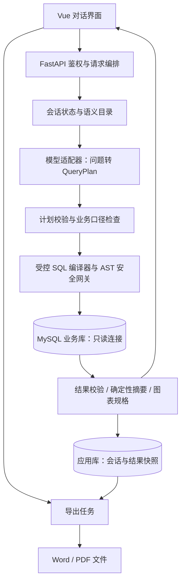

# 02 架构与查询实现方案

## 1. 总体架构

采用单仓库、前后端分离、模块化单体。查询服务和导出工作进程可分别启动，但不拆成多套业务微服务。首版单个 API 实例即可，避免过早引入消息中间件和分布式缓存。

## 2. 技术选择

用户已确认 Vue 3 + Python FastAPI + MySQL、本机部署、可切换大模型 API。下表中的配套库、数据库具体版本与模型候选仍属于实现规划，精确配置需在 G1 验证后锁定。

| 层次 | 拟采用方案 | 选择原因与约束 |
|---|---|---|
| 前端 | Vue 3、TypeScript、Vite | 对话、表格、状态管理便于组织 |
| 可视化 | Apache ECharts | 共用受控数据集与图表规格，不执行模型提供的 JavaScript |
| 后端 | Python FastAPI、Pydantic | 请求/计划结构校验、接口文档、适合模型与数据处理生态 |
| 数据访问 | SQLAlchemy Core + 经验证的 MySQL 驱动 | 绑定值参数、连接池、连接生命周期管理 |
| SQL 分析 | SQLGlot，明确指定 MySQL 方言 | AST 遍历与二次检查；不能把“可解析”当成“安全或正确” |
| 业务数据 | MySQL 8.4、InnoDB | 固定一种方言和运行时，减少兼容成本 |
| 模型 | 可切换 HTTP/供应商 SDK 适配器 | 模型 ID、版本、温度和超时可配置；实际选型以开发集实测为准 |
| 导出 | python-docx；Playwright + Chromium 打印 PDF | 两个渲染器消费同一报告快照，不依赖用户安装 Office |
| 测试 | pytest、前端组件测试、Playwright、固定请求负载脚本 | 分离正确性、界面及性能证据 |
| 缓存 | 进程内有界缓存，首版可关闭 | 小规模无需 Redis；缓存不是达标前提 |

依赖的精确版本在 G1 实测后固定至锁文件，不在规划阶段臆测“最新版本组合”。FastAPI 的结构校验能力见[官方文档](https://fastapi.tiangolo.com/features/)；SQLGlot 官方特别说明解析成功不等于引擎一定接受，故仍需数据库验证与本项目安全规则：[SQLGlot 文档](https://sqlglot.com/)。

## 3. 模块职责及未来目录

以下只是未来目录规划，本轮不创建代码目录或实现文件。

| 模块 | 职责 | 不负责的事 |
|---|---|---|
| `auth` | 登录、会话、资源所有权、角色权限 | 不把权限判断交给 LLM |
| `semantic` | 表字段、别名、指标、关系图、粒度与版本 | 不读取无关系统库供模型分析 |
| `conversation` | 已确认条件、多轮状态、澄清合并 | 不无限追加原始聊天文本 |
| `llm` | 模型协议适配、结构化输出、调用计时 | 无数据库凭据及执行权限 |
| `planner` | 校验 QueryPlan、实体解析、关系补全 | 不信任模型自报置信度 |
| `sql_guard` | AST 编译、白名单、参数绑定、复杂度限制 | 不靠字符串正则作为唯一防线 |
| `query` | 只读执行、取消、结果限量、快照 | 不写业务库 |
| `analysis` | 统计事实、摘要、图表规格 | 不进行无证据的经营归因 |
| `export` | 快照读取、图表渲染、Word/PDF、清理 | 不接受任意 URL/HTML/文件路径 |
| `evaluation` | 标准答案对照、时延、安全与失败报告 | 不把正式测试题加入提示示例 |

未来顶层拟包含 `frontend/`、`backend/`、`database/`、`tests/`、`evaluation/`、`docs/`、`artifacts/`。生成文件与源码分开，凭据不入库。

## 4. 核心链路：每一步怎么实现

### 4.1 输入与上下文

1. 验证登录身份、会话归属、数据源权限和请求长度（首版建议 1,000 中文字符以内）。
2. 记录服务端当前时间和时区；相对日期最终由服务端转换，不让模型凭自身“今天”推算。
3. 读取最近 5 轮的**已确认语义状态**。若该会话存在未完成请求，排队或提示等待，避免后发问题覆盖前一轮状态。
4. 通过词典、实体索引和关键词召回相关字段、指标、关系路径；初始 6 表规模无需向量库。
5. 将命中的少量元数据和开发集示例提供给 LLM；别名过于宽泛时允许补足关系路径，但仍限制 4 表。

### 4.2 模型输出契约

LLM 只输出结构化 `QueryPlan`，字段规划如下：

| 字段 | 含义及限制 |
|---|---|
| `action` | `query / clarify / unsupported` |
| `intent` | 明细、统计、排名、趋势、占比 |
| `metrics` | 语义目录指标 ID，最多 3 个 |
| `dimensions` | 已批准维度 ID，最多 2 个 |
| `filters` | 字段 ID、批准操作符、类型化值；不是任意 SQL 表达式 |
| `time_range` | 时间类型、显式日期或已批准的相对时间枚举 |
| `sort` / `top_n` | 合法字段、方向与数量上限 |
| `entity_mentions` | 待匹配的客户/商品名，解析到唯一 ID 后才执行 |
| `visualization` | 图表类型建议，可被规则引擎纠正 |
| `context_patch` | 追加、替换、清除哪些上轮条件 |
| `clarification` | 缺失信息和可选值，不包含可执行代码 |

优先选择支持 JSON Schema 约束的模型；只有 JSON 模式时仍需应用层类型与枚举校验。结构合法也不意味着业务正确。供应商对两种输出模式的区别见[千问结构化输出文档](https://help.aliyun.com/zh/model-studio/qwen-structured-output)。

提示词包含：当前语义目录版本、授权范围、指标定义、关联关系、合法输出模式、禁止猜测规则、少量开发集样例。默认低温度、不输出长推理过程；实际参数以供应商能力及复测结果固定。

### 4.3 计划验证与 SQL 生成

- 先验证指标与维度兼容、时间明确、实体唯一、关系图可达、聚合粒度安全。
- 关联路径来自服务端批准图，模型不能指定任意 JOIN 条件。
- 编译器将批准的聚合/过滤/分组操作组合成 AST，输出 MySQL SQL 和独立绑定参数。
- 标识符只能从目录映射；用户值只通过驱动绑定。动态列名不能用“参数化值”替代白名单。
- 一对多关系采用粒度检查、必要的受控 `EXISTS` 或预聚合，不能用 `SUM(DISTINCT 金额)` 错误去重。
- 最终 SQL 再解析检查 AST、所有子查询、物理表、列、函数及复杂度；每次执行只能是一条只读语句。
- SQL 模板针对查询算子，不针对固定自然语言题目；能够组合未见过的合法条件。

此路线仍然是 LLM 驱动的自动 SQL 查询，只是把“生成查询语义”和“生成安全 SQL 文本”分层。若后续启用模型直出 SQL，必须走相同安全网关，且作为独立模式评测，不能无验证地降级直跑。

### 4.4 执行、摘要与图表

1. 从独立只读连接池获取连接，应用本请求剩余时限。
2. 执行受控 SQL。对于同时需要明细和全局统计的请求，最多执行 2 条独立验证的 SELECT，并置于同一短只读一致性事务中；总耗时共同计入数据库预算。
3. 明细最多取 1,001 行探测截断，保留前 1,000 行；分组最多取 501 组检查越界，超过 500 组要求缩小范围。
4. 按列类型、单位、指标口径解释结果，金额使用十进制；摘要只引用可追溯结果字段。
5. 生成不含代码的 `chart_spec`，由前端受控映射为 ECharts 配置。
6. 写入应用库结果快照及版本信息，成功后返回窗口；同一快照用于分页、图表切换和导出。

图表类型切换若所需数据已在快照中，不调用 LLM、不重新查库；若改变维度或聚合粒度，则形成新查询。ECharts 数据与配置分离的依据见[官方 dataset 文档](https://echarts.apache.org/handbook/en/concepts/dataset/)。

### 4.5 一条可验证的端到端示例

输入：“2026 年 9 月华东地区销售额最高的 5 个客户。”

1. 意图：排名；指标：销售额；维度：客户；地区：华东；月份：2026-09；Top N：5。
2. 服务端将日期解析为 9 月 1 日至 10 月 1 日，使用订单销售地区快照和有效销售状态。
3. 选择订单与客户关系；以客户 ID 聚合订单金额，按金额降序、客户 ID 升序稳定排序。
4. 编译并验证参数化 SQL，执行只读查询。
5. 返回 5 个客户、金额、柱状图和“当前范围内排名”；不得把 Top 5 总额说成华东全部销售额。
6. 保存快照；导出的 Word/PDF 复用同一批数值，不重新查询。

G1 必须先证明这类窄闭环正确，再增加功能。

## 5. SQL 与数据安全设计

### 5.1 多重防线

- **数据库权限**：`query_reader` 仅获得批准业务表/视图的 SELECT；不授予 FILE、EXECUTE、写操作或管理权限。`app_writer` 只能写应用库，两种连接不可混用。初始化管理员凭据不进入运行环境。
- **AST 白名单**：只允许首版算子和函数；拒绝多语句、写入、DDL、`INTO OUTFILE`、`LOAD_FILE`、`SLEEP`、`BENCHMARK`、锁函数、用户变量、系统变量、任意 UDF、锁定读及跨库对象。
- **注释与提示**：不接受用户/模型注入的版本注释、优化器提示；如需执行时限提示，由服务端在校验后可信添加。
- **元数据隔离**：业务查询不得访问 `mysql`、`sys`、`performance_schema` 等系统对象。管理端若需元数据扫描，采用单独受限路径。
- **执行控制**：数据库执行上限、驱动网络超时、请求 deadline、返回行数及字节大小均限制。`LIMIT` 不代表查询一定便宜。
- **取消与连接回收**：请求取消要触发经验证的驱动取消/服务器终止机制；超时连接不直接归还池。若需要辅助终止连接，其权限必须单独最小化，不直接给查询账户管理员权限。

MySQL 的 SELECT 时限可利用 `MAX_EXECUTION_TIME`/对应会话变量，但适用范围有限，仍须实测取消与池清理：[官方优化器提示文档](https://dev.mysql.com/doc/refman/8.4/en/optimizer-hints.html)。最小权限设计参考 [MySQL 权限说明](https://dev.mysql.com/doc/refman/8.4/en/privileges-provided.html)。

### 5.2 模型、界面与导出

- 问题、表注释、数据库内容都按不可信数据处理，不能覆盖系统规则或安全网关。
- 默认不把原始结果明细发送到外部模型；只提供批准元数据、脱敏必要实体与用户问题。
- Markdown/HTML、表格单元格、图表标题、导出内容统一转义；模型不能提供 formatter 函数或脚本。
- 预置账号采用密码哈希及服务端会话，Cookie 设置 HttpOnly/SameSite；写接口做来源/CSRF 防护。非本机部署要求 HTTPS。
- 用户、会话、结果、导出任务、下载链接逐项检查归属；不可只依赖前端隐藏按钮。
- 管理员配置的数据源主机和模型 endpoint 要受控；普通用户不能用系统访问任意内网地址。
- 日志不记录密码、API Key、完整敏感明细；审计中的 SQL 使用参数占位及脱敏参数。

## 6. 延迟预算与退化方案

以下为**工程预算，不是现有测量值**：

| 阶段 | 单请求预算 |
|---|---:|
| 浏览器到应用的网络与排队 | 150 ms |
| 鉴权、上下文、语义召回 | 100 ms |
| 单次 LLM 完整结构化输出 | 1,350 ms |
| 计划校验与 SQL 编译 | 100 ms |
| 数据库完整执行与取数 | 450 ms |
| 摘要、图表规格、快照持久化 | 150 ms |
| 传输及浏览器实际渲染 | 250 ms |
| 波动余量 | 450 ms |
| 合计 | 3,000 ms |

各阶段预算相加只是设计工具，不代表分阶段 P95 相加就能证明整体 P95。必须实际测量浏览器端到端分布。

优化顺序：缩短输出 → 精简相关 schema → 复用 HTTP/数据库连接 → 优化 JOIN 与索引 → 减少串行调用 → 选择实测更快模型 → 最后考虑缓存。不能删掉安全检查换速度。

- 普通路径只调用模型 1 次，默认不自动重试；网络/结构错误返回可重试状态并计为失败。
- 用户主动重试形成可追踪的新尝试；原失败不能从验收统计删除。
- 超过 3 秒即记慢请求，界面继续显示真实状态；端到端硬截止建议 8 秒，之后取消并提示失败。3 秒不是用来掩盖超时的断线门槛。
- 池耗尽/达到 5 个活动查询时采用有界队列；等待时间计入响应时间，过载拒绝单独统计。
- 可选缓存键包含用户权限范围、规范化语义状态、解析后的绝对日期、schema/指标/数据版本、模型和提示词版本；仅使用问题文本作为键不合格。
- 演示冻结数据可按数据版本缓存；接入可变数据默认不缓存结果，除非明确 TTL 和可接受的陈旧窗口。缓存结果必须显示真实数据时间。

## 7. 可观测性

每次记录 `request_id`、模型/提示词/语义版本、数据快照版本、各阶段时延、token 数、计划与 SQL 指纹、行数、缓存状态、结果/错误类型。前端额外记录表格和图表可用时刻，用于端到端测量。

标准错误类别：`NEEDS_CLARIFICATION`、`OUT_OF_SCOPE`、`FORBIDDEN`、`MODEL_UNAVAILABLE`、`INVALID_PLAN`、`QUERY_TIMEOUT`、`RESULT_TOO_LARGE`、`EXPORT_FAILED`。日志保留可复现证据，用户界面不暴露底层堆栈或连接串。
