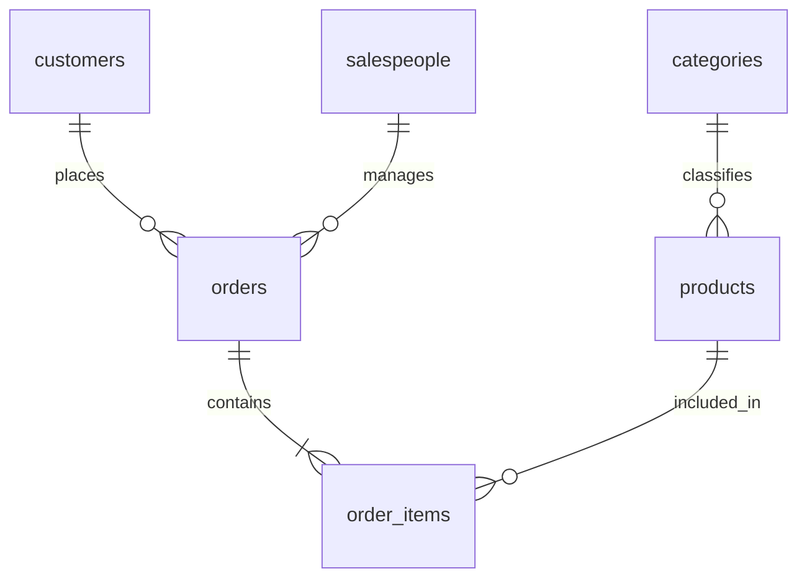

# 03 数据接口与交互设计

> 本文仅定义设计契约，不包含可执行建库脚本或接口代码。

## 1. 业务数据模型

| 表 | 主键与主要字段 | 关系与作用 |
|---|---|---|
| `customers` | `id, customer_code, name, region` | 一个客户多个订单；`region` 是当前客户地区 |
| `salespeople` | `id, name, department` | 一个销售人员多个订单 |
| `categories` | `id, name` | 一个类别多个商品 |
| `products` | `id, sku, name, category_id` | 一个商品多条订单明细 |
| `orders` | `id, order_no, customer_id, salesperson_id, sales_region, status, created_at, paid_at, paid_amount` | 订单头；`sales_region` 是成交地区历史快照 |
| `order_items` | `id, order_id, product_id, quantity, unit_price, line_paid_amount` | 订单行；一单多行，不重复统计订单头金额 |

约束规划：

- ID 主键、业务单号唯一、SKU 唯一；客户/商品名称允许重复。
- 外键关系与非空约束以实际业务确定；演示数据不得出现孤儿明细。
- 金额类型 `DECIMAL(18,2)`；数量正整数；销售状态固定枚举集合。
- `PAID/SHIPPED/COMPLETED` 必须有 `paid_at`；未支付订单不参与销售额。
- `line_paid_amount` 已含行级折扣分摊，不必等于单价乘数量；各行金额总和必须等于订单金额。
- 首版默认查 `sales_region`；用户明确问“客户当前地区”时才使用 `customers.region`，并说明含义。
- 演示数据不支持商品类别历史调整；如真实业务需要历史维度，必须增加快照字段或历史维表。

### 1.1 数据规模与构造

- 标准数据：10 万订单、30 万明细、约 1 万客户、1,000 商品、20 类别、50 销售人员，覆盖连续约 24 个月。
- 固定随机种子、生成器版本和数据校验摘要；时间覆盖在正式评测前冻结。开发演示可更新数据，但必须更新数据版本。
- 大规模压力集可扩大 10 倍，仅用于容量探索，不与标准验收结果混报。
- 额外构造手算微型数据集：跨月边界、闰年、零成交、重名客户、多明细订单、折扣、并列排名、无匹配结果、空值。
- 至少准备 3 个变体数据快照，打破“客户名与地区固定对应”“每单只有一条明细”等偶然规律。

### 1.2 索引候选

基线包括外键索引以及 `orders(paid_at, status)`、`orders(sales_region, paid_at)`、`orders(customer_id, paid_at)`、`order_items(order_id)`、`order_items(product_id, order_id)`、`products(category_id)`。是否增加 `orders(status, paid_at)` 等组合索引应由典型查询与 `EXPLAIN` 验证，不是把所有候选都建一遍。

避免在时间过滤中对索引列包裹日期函数；先使用日期范围过滤，再按日期/月聚合。执行计划估算不是准确耗时保证；正式验收以真实执行为准。

## 2. 语义目录

每个目录版本至少包含：

| 对象 | 元信息 |
|---|---|
| 表/字段 | 物理名称、语义 ID、中文名、同义词、类型、是否敏感、是否可查询 |
| 指标 | 公式、基础粒度、允许维度、状态过滤、时间字段、单位、空值规则 |
| 关系 | 主外键、基数、一对多风险、允许 JOIN 类型和可用路径 |
| 实体 | 允许暴露的名称、ID 映射、重名处理方式 |
| 日期 | 时区、相对时间规则、数据覆盖范围 |
| 示例 | 只来自训练/开发题库的问法与计划，不包含盲测题 |

目录不是仅把 `SHOW CREATE TABLE` 发给模型。所有新增字段、指标或关系必须经管理员审核，更新版本后使相关缓存失效并回归测试。

## 3. 应用库与业务库分离

同一 MySQL 实例可划分 `erp_demo` 业务库与 `nlq_app` 应用库，但使用不同账号和连接池。

| 应用对象 | 保存内容 |
|---|---|
| `users` / `sessions` | 演示账号、密码哈希、角色与登录状态 |
| `conversations` / `messages` | 会话归属、问题、回答状态与追溯引用 |
| `query_runs` | 计划、绑定参数脱敏记录、SQL 指纹、版本、耗时、错误分类 |
| `result_snapshots` | 有界结果、列类型、完整统计、摘要事实、图表规格、创建及过期时间 |
| `export_jobs` | 任务归属、快照 ID、格式、状态、文件标识、校验和 |
| `semantic_versions` | 生效目录版本及变更摘要 |

结果快照建议保留 7 天，导出文件保留 24 小时，脱敏审计保留 30 天，均可配置。快照过期后显示“结果已过期，请重新查询”，不能悄悄替换成新数据。文件清理必须限定在系统导出目录内。

## 4. 接口契约草案

所有接口带请求追溯 ID；非公开接口均需鉴权。路径只是后续实现约定，不代表已经可用。

| 方法与路径 | 输入 | 输出/规则 |
|---|---|---|
| `POST /api/auth/login` | 用户名、密码 | 登录会话，不返回数据库或模型凭据 |
| `POST /api/auth/logout` | 当前会话 | 会话失效 |
| `POST /api/conversations` | 可选标题 | 当前用户的会话 ID |
| `GET /api/conversations/{id}` | 会话 ID | 本人的消息和结果引用 |
| `POST /api/conversations/{id}/queries` | 问题、幂等键、可选澄清引用 | 成功结果、澄清、拒绝或明确错误 |
| `GET /api/results/{id}` | 结果 ID、页码 | 对固定快照分页，不能任意改 SQL |
| `POST /api/results/{id}/chart` | 受限图表类型 | 能用现有快照则重绘；需要新数据则提示发起新查询 |
| `POST /api/results/{id}/exports` | `docx` 或 `pdf`、是否附 SQL | 返回 `202`、导出任务 ID；点击后自动轮询并下载 |
| `GET /api/exports/{id}` | 任务 ID | `pending/running/succeeded/failed/expired` |
| `GET /api/exports/{id}/download` | 成功任务 ID | 鉴权后下载，用户不可指定服务器路径 |
| `GET /api/admin/semantic-catalog` | 管理员身份 | 生效目录及版本 |
| `GET /api/health/ready` | 无敏感参数 | 就绪状态，不输出连接串 |

首版查询采用一次完整请求响应，前端展示等待状态，不以 SSE 为必要依赖；后续可以增加进度事件，但仍以完整结果就绪计算 3 秒。

### 4.1 成功结果对象

至少包含 `query_id`、`result_id`、`status`、`interpreted_question`、`assumptions`、`time_range`、`metric_definitions`、`answer`、`columns`、`rows`、`statistics`、`chart_spec`、`sql_display`、`truncated`、`snapshot_at`、`versions`、`timing`。

- 金额以十进制字符串传输；展示和计算层不能因 JavaScript 浮点导致金额漂移。
- 日期按声明时区输出；单位和字段含义随列元数据提供。
- `rows` 默认为首屏 20 行，完整有界快照由服务端保存。
- `truncated=true` 时说明保留上限；不知道全量条数时不编造“共 N 条”。
- `sql_display` 是经过处理的 SQL，不含连接凭据；参数按权限脱敏。
- `chart_spec` 只允许图表类型、轴字段、序列、标签、单位及已批准的简单选项，不包含函数、HTML 或外部资源 URL。

### 4.2 状态与失败

业务状态区分 `success / needs_clarification / unsupported / failed`；空结果属于 `success`，但需要显示“本条件下无数据”。鉴权失败、过载、上游不可用、超时分别使用适当 HTTP 状态，并有统一错误体。

幂等键与用户、会话绑定，避免双击触发两次收费模型调用。客户端取消后记录取消状态，不把尚未完成的结果记为成功；多轮状态只由成功查询或明确确认的澄清更新。

## 5. 页面与交互规划

### 5.1 主页面

- 左侧：新建会话、历史会话、数据源及数据覆盖说明。
- 中间：对话消息流；每条成功回答含口径条、摘要、图表、表格分页、SQL 折叠区、Word/PDF 两个按钮。
- 底部：问题输入、发送/取消按钮、示例问题；示例必须符合数据覆盖，不能演示空月份又声称有结果。
- 顶部/设置：登录用户、数据源、模型配置状态；只展示配置是否有效，不回显密钥。
- 管理页：语义字典、连接测试、脱敏审计与评测摘要，首版从简。

### 5.2 必备状态

初始、查询中、成功、无数据、需要澄清、超出范围、权限拒绝、模型失败、数据库超时、结果截断、导出中、导出失败、快照过期。

键盘 Enter 发送、Shift+Enter 换行；按钮有文字标签；表格列头与图表轴都有单位。错误后保留用户问题，允许修改重试。用户切换会话时，不能把旧会话的迟到响应插入新会话。

## 6. Word/PDF 导出详细路线

1. 用户点击格式按钮，后端验证结果快照归属和有效期，创建持久化任务。
2. 独立轻量工作进程消费应用库中的待处理任务；首版导出并发 1，避免 Chromium 抢占查询资源。进程重启后可恢复未完成任务，任务必须幂等。
3. 从可信快照构建统一 `ReportPayload`：问题、时间、口径、事实摘要、列和行、图表规格、追溯信息。
4. 使用本地静态模板和本地 ECharts 资源渲染图表，禁用动画，等待字体与图表完成后生成 PNG；不加载用户指定地址。
5. Word：python-docx 写入标题、段落、可编辑表格及图表 PNG，设置中文字体和表头重复。
6. PDF：同一报告数据渲染为打印 HTML，使用 Playwright Chromium 输出 A4 PDF；宽表可横向，页眉页脚包含追溯 ID 和页码。
7. 校验生成结果，保存文件摘要；前端自动下载或给出明确下载入口。
8. 按保留周期清理文件和过期下载授权。

python-docx 支持表格和图片，但不是 PDF 转换器：[官方快速入门](https://python-docx.readthedocs.io/en/latest/user/quickstart.html)。PDF 使用 Playwright 的页面打印能力，并控制打印样式：[Playwright PDF 文档](https://playwright.dev/python/docs/api/class-page#page-pdf)。

验收必须实际打开 Word/PDF，检查中文、长表跨页、图表标签与金额一致性，不能以“成功生成文件”代替视觉验收。标准小报告（≤100 行、≤2 图）以导出 P95 ≤10 秒为目标；最多 1,000 行的大报告单独以 60 秒硬超时控制，并展示真实进度。导出速度与查询 3 秒指标分开报告。
